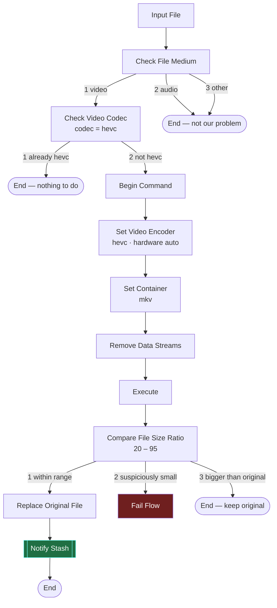

# Tdarr flow — Windows node, Stash in Docker on a separate Linux box

Your topology, which drives most of the decisions below:

```
┌─────────────────────────┐          ┌──────────────────────────────┐
│ Windows                 │   SMB    │ Linux media server           │
│  Tdarr server + node    │ ───────► │  /mnt/media  (real storage)  │
│  sees  Z:\Media\...     │          │  Docker: Stash               │
│                         │  HTTP    │   mounts it as /data         │
│                         │ ───────► │   :9999                      │
└─────────────────────────┘          └──────────────────────────────┘
```

Two different machines means two different path vocabularies for the same file. That is
what the plugin's **path map** exists to reconcile, and it is the single most likely thing
to go wrong.

## Import it

**[`tdarr-flow/Stash-HEVC-Flow.json`](tdarr-flow/Stash-HEVC-Flow.json)** — Tdarr → Flows →
Import, paste the file contents.

Nothing needs installing on the Tdarr side. The Stash notification is a Community
**Custom JS Function** node with the code inlined, so the flow is self-contained. The
standalone `tdarr-plugin/notifyStash/` version is still there if you would rather install
it as a proper local flow plugin, but you do not need both.

After importing, open the **Notify Stash** node (it is the bottom one, and its title says
so) and set the two constants at the top of the code:

```js
const STASH_URL = 'http://STASH-HOST:9999';   // your Linux box, as seen from Windows
const STASH_API_KEY = '';                      // Stash > Settings > Security > API Key
```

`STASH-HOST` is a deliberately invalid placeholder so it fails loudly in the job log if
you forget.

Regenerate the JSON after editing with `python tdarr-flow/build_flow.py`.

## The flow



Branches 2 and 3 of the size check deliberately **do not** reach Notify Stash. If the
original file was never replaced, Stash's database is still correct and there is nothing
to sync.

## Node-by-node

What the imported flow contains, in case you want to rebuild or tweak it by hand. Names
below are the node titles as they appear in the plugin picker.

| # | Node | Settings | Why |
|---|---|---|---|
| 1 | **Input File** | — | Flow entry point |
| 2 | **Check File Medium** | — | Output 1 is video; send 2 and 3 straight to the end |
| 3 | **Check Video Codec** | Codec: `hevc` | Output 1 means already HEVC → end. Output 2 continues. This is what stops Tdarr re-encoding its own output forever. |
| 4 | **Begin Command** | — | Starts the ffmpeg command builder |
| 5 | **Set Video Encoder** | Output Codec `hevc`, Preset `slow`, Quality `24`, Hardware Encoding `on`, Hardware Type `auto`, Hardware Decoding `on`, Force Encoding `off` | See the hardware note below. Force Encoding off so already-HEVC streams are never re-encoded. |
| 6 | **Set Container** | Container: `mkv` | This is the step that changes the extension, and therefore the step that makes the Stash merge necessary |
| 7 | **Remove Data Streams** | — | Data streams frequently break mkv muxing |
| 8 | **Execute** | — | Runs the assembled command |
| 9 | **Compare File Size Ratio** (v2) | Greater Than `20`, Less Than `95` | Output 1 within range → keep. Output 2 → Fail Flow for manual review. Output 3 → end, discard the transcode. |
| 10 | **Replace Original File** | — | Deletes the old `.avi`/`.mp4` and puts the `.mkv` in its place |
| 11 | **Notify Stash** | see below | **Must be last.** Before node 10 runs, `inputFileObj._id` still points at the cache copy. |

Optional extras worth adding once the core flow works: **Run Health Check** before node 9,
and **Remove Subtitles** if your library has image-based subs that bloat the mux.

### Why `Less Than` is 95, not the default 110

The default band of 40–110 accepts an output up to 10% *larger* than the input, which for
a space-saving flow is a pure loss. 95 means "only keep it if it actually saved something".
And 20 rather than 40 as the floor, because HEVC off an old DivX or MPEG-4 source
legitimately lands well under 40% and the default would throw those away.

### Hardware note

Tdarr's **Set Video Encoder** hardware dropdown offers `auto`, `nvenc`, `rkmpp`, `qsv`,
`vaapi`, `videotoolbox`. There is **no AMF**, so:

- **NVIDIA** → works. Consider pinning to `nvenc` rather than `auto`, so a broken driver
  fails loudly instead of silently falling back to CPU at 10% of the speed.
- **Intel iGPU / Arc** → works, pin to `qsv`.
- **AMD Radeon on Windows** → `auto` will not find a hardware encoder. You get libx265 on
  the CPU. Still works, just budget hours per file rather than minutes.

I have left it on `auto` since I do not know what is in the box. Change this one node.

### Performance note for your setup

Tdarr on Windows reading and writing over SMB means a 10 GB file crosses the network
twice. Set the **Transcode Cache** on the Tdarr node to a **local Windows SSD** path
(Tdarr → Options → Transcode Cache). The working file then stays local and only the final
replace goes over the wire.

## Notify Stash node settings

These are constants at the top of the Custom JS Function code in the imported flow.

| Constant | Value |
|---|---|
| `STASH_URL` | `http://<linux-box-ip>:9999` — as reachable **from the Windows node**, not from your browser |
| `STASH_API_KEY` | Stash → Settings → Security → API Key |
| `QUEUE_DIR` | optional, see below. Written as a JS string, so double the backslashes: `'Z:\\tdarr-queue'` |

The node never fails the flow: a bookkeeping failure should not undo a good transcode.

## The path map — the part that actually matters

Set this in **Stash → Settings → Plugins → Tdarr Sync → Path map**.

Format is `from=>to`, pipe-separated, longest prefix wins. `from` is what **Tdarr** reports,
`to` is the path **as Stash sees it inside its container**.

To find the two halves:

1. **Tdarr side.** Look at a completed job in Tdarr. The file path it shows is the `from`
   half, e.g. `Z:\Media\Movies`.
2. **Stash side.** Stash → Settings → Library → the configured library paths. These are
   container-internal paths, e.g. `/data/movies`. **Not** the Linux host path, and not the
   left-hand side of your `docker run -v` flag.

Worked example, for a Linux host storing media at `/mnt/media`, a Stash container started
with `-v /mnt/media:/data`, and a Windows drive `Z:` mapped to that same share:

```
Z:\Media=>/data
```

If you have several shares or drive letters, chain them:

```
Z:\Media=>/data|Y:\Archive=>/archive|\\MEDIASRV\incoming=>/incoming
```

Drive-letter and UNC rules are matched case-insensitively, because Windows does not care
whether Tdarr reports `Z:\Media` or `z:\media`. Plain Linux-to-Linux rules stay
case-sensitive.

### Verify it before you trust it

Stash → Settings → Tasks → Plugin Tasks → **Tdarr Sync → Test Connection**, then read
Settings → Logs. It prints your library paths, the parsed rules, and — if you pass a
`newPath` arg — whether the mapped path exists and falls inside a library path.

## Networking checklist

- Stash's container publishes 9999 to the Linux host (`-p 9999:9999`).
- The Linux firewall allows 9999 from the Windows box.
- `curl http://<linux-ip>:9999/healthz` from the Windows machine returns something.
- Stash has an API key set, and you have pasted it into the Notify Stash node.

## Permissions

Tdarr writes the new file over SMB, so its ownership on the Linux side is decided by
**Samba**, not by Tdarr. If Stash ends up unable to read transcoded files, fix it in
`smb.conf` on the Linux box — `force user`, `create mask = 0664`, `directory mask = 0775` —
rather than in the flow. Tdarr's *Set File Permissions* node is a no-op from a Windows node
and will not help you here.

## First run

1. Stash → Settings → Tasks → **Backup** the database. `sceneMerge` is not reversible.
2. Plugin settings: tick **Dry run**.
3. Run **Test Connection**, fix anything it complains about.
4. Point the flow at a library of **one** file you do not care about. Run it.
5. Read Stash → Settings → Logs. You want to see the original scene identified and a
   "DRY RUN: would scan ... and merge it onto scene N" line with a plausible scene id.
6. Untick Dry run. Run the same single file again for real.
7. Confirm in Stash that the scene kept its id, tags and o-counter and now points at the
   `.mkv`.
8. Only then let it loose on the library.

## If events go missing

Two safety nets, both optional:

- **Queue directory.** Give the Notify Stash node a spool path and give Stash the same
  directory as it sees it. Failed HTTP calls get written there as JSON, and the
  **Drain Queue** task picks them up. Worth putting on a schedule.
- **Reconcile Orphans.** Matches vanished-file scenes to new scenes by perceptual hash,
  which survives re-encoding. Run it with Dry run first. This also retroactively repairs
  transcodes from before you installed any of this.
